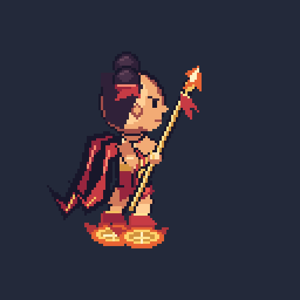
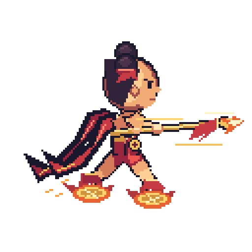

# 哪吒普攻：逐帧编排

孩童哪吒，双髻、红肚兜、混天绫、火尖枪与风火轮。128×128，朝右，12 帧、1070 ms。以已选中的哪吒动画为视觉基准，整理为可重跑的逐帧制作示例。





## 重跑

需要 Python 3、ffmpeg 和支持基础绘制/帧/图层/导出命令的 PixelForge CLI（本包使用 0.1.0-rc.5）。所有像素编辑都通过 CLI 完成。Python 只组织绘制请求，ffmpeg 只包装 CLI 导出的动画。

```bash
PIXELFORGE=/path/to/pixelforge python3 demos/nezha-frame-attack/build.py
PIXELFORGE=/path/to/pixelforge python3 demos/nezha-frame-attack/validate.py
```

从空目录重跑：

```bash
PIXELFORGE=/path/to/pixelforge python3 demos/nezha-frame-attack/build.py --out /tmp/nezha-repeat
PIXELFORGE=/path/to/pixelforge python3 demos/nezha-frame-attack/validate.py --root /tmp/nezha-repeat
```

`reports/stamp.json` 记录 CLI 版本、二进制哈希和交付物哈希。`source/body.pxf.json` 是只有头部/躯干像素的可编辑底稿，其余动作层为空，不依赖仓库外的旧工程。`source/poses.json` 明确写出每一帧的身体位移、头部前倾、握点、枪角度、双脚落点、红绫偏移和时长。

## 逐帧怎么编排

| 阶段 | 帧 | 看什么 |
| --- | --- | --- |
| 准备 | 0 | 哪吒、枪和红绫的清楚轮廓 |
| 蓄力 | 1–3 | 身体后移下沉，前脚抬起，手臂收枪 |
| 蹬地与刺出 | 4–6 | 身体前送，前脚迈出落定，出枪加速 |
| 收势 | 7–11 | 身体回弹、收脚收枪，红绫延后回摆 |

制作时先确定关键姿势，再安排帧间节奏。每帧从已有帧复制，恢复共用的身体底稿后修改身体/头部的位移；移动层按该帧明确的姿势重新画。像素复用是省重复工作，发力需要变化的部位照样改。

四层从后到前：`silk`、`legs-and-wheels`、`body`、`arms-and-spear`。角色身份与体积来自固定底稿，脚步、火轮、手臂和红绫按帧编排。枪杆每帧用同一条直轴和长度绘制，枪缨与红绫使用独立偏移。画面中的惯性来自逐帧设计，不称为物理模拟。

这里不用曲线、部件、IK、接触约束或 bake。项目里相应元数据为空，重跑也不调用这些能力。教材重点是关键姿势、身体发力、脚步、刚性道具、附属物跟随和播放节奏。

## 文件与验收

- `final/nezha-attack.gif`：直接观看的深色背景预览；`nezha-attack.apng` 保留透明背景和精确时长。
- `final/nezha-attack.pxf.json`：12 帧可编辑工程；`nezha-attack-sheet.png` 与 atlas 为 6×2 图集。
- `final/poses/`：准备、蓄力、出枪、收势关键帧。
- `validate.py`：检查图层/帧/色板、下肢确有变化、脚踝与轮子的像素连接、枪杆连续性、标签、导出时长、图集及文件哈希。
- `CAPABILITIES.md`：CLI 操作、逐帧数据、提交能确认的造型来源，以及上述检查各自证明的范围。

结构和连续性检查不能给动作的自然度打分。完整观看 GIF/APNG，结合关键帧审阅蓄力、刺出、回弹与红绫跟随；`aestheticApproval` 保持 false，最终以人工审阅为准。角色脚下是风火轮，不把火焰的最低像素当作脚底接触点。轮子与特效仍为简化表现，不是完整物理解算。此示例只有朝右普通攻击，不声称覆盖八向攻击。

## 许可

美术资源 CC BY 4.0，见 [LICENSE-ASSETS.md](../../LICENSE-ASSETS.md)，署名 PixelForge / starcloud530，注明 CLI 绘制、AI 辅助编排。脚本沿用仓库 MIT OR Apache-2.0 许可。
