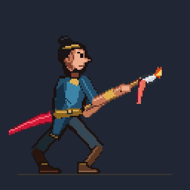
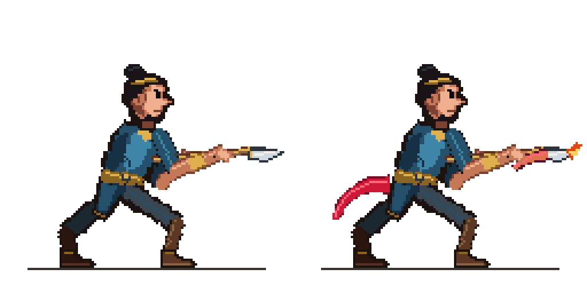

# 侧视跨步刺击

128×128 索引色，侧视朝右，16 帧、1290 ms 的单次动作。成年神话枪兵：束发、短须、蓝色短袍、裤靴和护腕；红绫系在腰后。这个示例展示曲线、双腿/双臂 IK、脚底接触、握持、attach、bake 与最后的像素整理如何协作。`aestheticApproval: false`，仍待人工审阅。





## 重跑

从 pixelforge-ai 提交 `b647dc1631e639b34279e6027825430b0a3ce1b2` 编译 CLI。`--version` 仍显示 `0.1.0-rc.5`；版本字符串或技能文本本身不能证明构建来源，使用者需确认检出的提交。

```bash
cargo build -p pixelforge-cli --release
PIXELFORGE=/path/to/pixelforge python3 demos/spear-lunge/build.py
PIXELFORGE=/path/to/pixelforge python3 demos/spear-lunge/validate.py
```

需要 Python 3 和 ffmpeg。像素只由 CLI 的矩形、多边形、椭圆和线段写入，Python 不生成位图或修改工程里的像素。`source/rest.pxf.json` 是静止素材；`source/motion.json` 记录关键帧、求值后的挂点、接触区间与跟随曲线。`final/` 包含可编辑工程、精灵表、APNG、GIF、关键帧和审查 MP4。

`bake --fps 12` 是初始采样设置。导出前按 `brief.json` 的 `frameDelaysMs` 写入各帧时长；APNG 和 MP4 使用这些时长，GIF 按格式的 10 ms 精度存储。MP4 和 GIF 为方便审阅重复动作；动作结束在前移后的弓步，重播时会重置到准备姿势，不是无缝走路循环。

工程输出去除 JSON 空白以控制体积，数值不变。`work/`、放大帧和力学工程副本不提交。用 `--out /tmp/lunge-repeat` 重跑可比较工程与精灵表的 SHA256。

## 设计与实现

| 阶段 | 帧 | 动作意图 |
| --- | --- | --- |
| 准备与蓄力 | 0–3 | 先停稳，骨盆后移下沉，前臂收枪 |
| 跨步 | 4–6 | 后脚支撑，前脚离地沿弧线送出，身体开始前移 |
| 刺出 | 7–8 | 前脚落定，骨盆、躯干、肩臂和枪共同前送 |
| 收势 | 9–15 | 落地承重，躯干回稳，布料与枪缨延后回摆 |

### 脚掌与小腿分开

两条短链 IK 求解腿部，前脚准备时在 (56,116)，迈步后落在 (74,116)；后脚支撑在 (30,116)。离地帧用单帧目标，不把它们解释成地面支撑。

`foot-near` / `foot-far` 是独立图层和部件，脚底通过 attach 跟随小腿的 IK 末端。小腿可以转动，靴子不用随小腿整块旋转；支撑期鞋底水平，前脚离地时才上翘。校验同时核对鞋底部件与 IK 末端，避免只验证不可见的骨架点。

### 躯干、双手和枪

骨盆与躯干曲线先确定发力姿势，再从 `constraint solve` 的实际画布挂点驱动肩/髋位置。双臂 IK 跟随枪的两个握点，手掌 attach 到握点。静止锚点偏移不能替代求值后的坐标。

造型在静止源帧中整理：收窄并塑造鞋尖、加粗且收拢关节轮廓、分出短袍衣摆和腰带、用束发/耳朵/眉眼/下颌构成侧脸。关键帧对照去掉服饰效果后，仍应能读出身体的姿势。

### 刚性枪杆的像素整理

细枪杆直接旋转已栅格化的像素，再进行覆盖补洞，可能在某些角度出现孔洞、轮廓增厚和逐帧跳变。这个示例在 bake 后读取同一套枪部件曲线和握点，用唯一的刚性源几何做旋转/平移，再通过 CLI 的四边形与线段重新落格绘制枪层；枪尾、枪杆和枪头使用同一个变换，没有各自的延迟或形变曲线。

这是像素轮廓整理，不改变手臂 IK 或握持轨迹。修改运动后需要重跑 `finish_rigid_spear`，只重新 bake 会再次得到旋转重采样后的原始像素。`validate.py` 独立检查实际枪层的中心线是否连续、杆身是否偏离直线，以及枪尾长度是否稳定，不能只看握点求解成功。

### 连续红绫与枪缨

原有分段部件、旋转曲线和 attach 链保留为可编辑运动骨架。末端曲线比根部延后，并在恢复阶段收回；这是手工编排的跟随，不是物理模拟。

烘焙后，脚本从求值后的根点和各段末端取一条 Catmull–Rom 连续中心线，沿法线生成逐渐变窄的带状多边形，再通过 CLI 写入 `ribbon-finish` / `tassel-finish` 两个 polish 层。刚性导向层隐藏，避免三根硬杆直接拼成布料。挂接点保持在约束位置。

这两个 polish 层是逐帧结果，不绑定到单个刚性部件。修改曲线后要重跑完整构建（包含 `smooth_cloth`），仅重新 bake 不会自动更新曲面整理。高光仍是简化表现，旋转的肢体也仍可能出现像素台阶。

## 检查范围

`validate.py` 独立调用 CLI 求解与预览，检查脚印区间、双手握持、布料挂点、脚掌与小腿连接、逐帧时长、整理层可见性、枪杆刚性轮廓、图集及输出哈希。求解通过只证明几何关系，不给自然度打分。

视觉审查需分别看：准备、离地、落地与刺出、收势的关键帧，以及按实际时长播放的完整动作。不能仅凭静态图宣称播放自然。`reports/` 保留求解、烘焙和校验结果；播放观察与尚存限制另见 `reports/visual-review.md`。

## 许可

画面 CC BY 4.0，见仓库 [LICENSE-ASSETS.md](../../LICENSE-ASSETS.md)。署名 PixelForge / starcloud530，并说明素材由 CLI 绘制、AI 辅助编排。脚本遵循仓库 MIT OR Apache-2.0。
